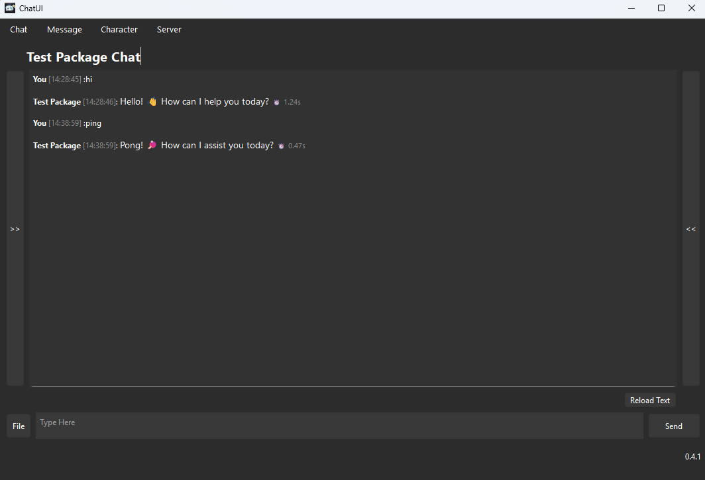
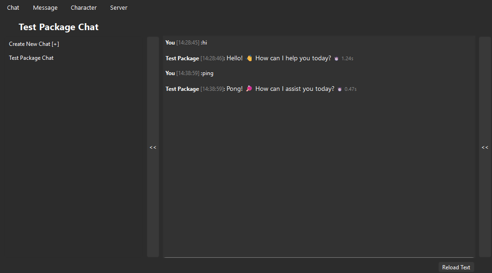
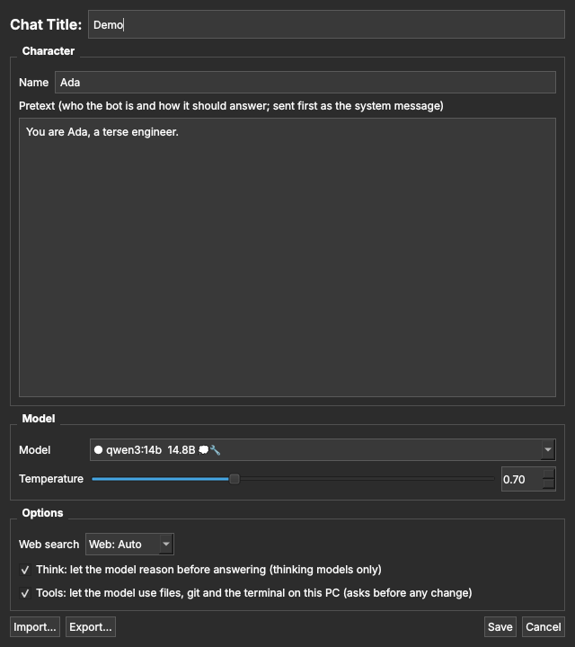
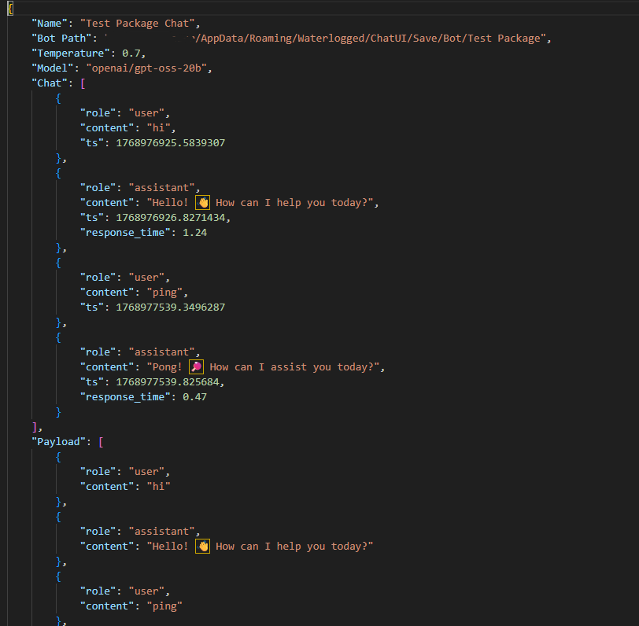

# Custom ChatUI At Home
# 1. Introduction
LLM chatbots are all the rage now a days.  I feel like it would be fun to make my own chat bot.

# 2. The LLM
This project WILL NOT focus on the LLM itself.  I didn't train my own LLM. I don't have the hardware or knowledge to pull of such a feat.

## 2.1. Setup
### Server
- AMD 9xxxX3D
- 64GB of Ram
- RTX5090
- Ubuntu 24.04

### Client
- Windows PC

## 2.2. Server
Despite such beefy of a machine.  I'm still choking on both d and v ram, besides since I wanted to access the chatbot remotely in the future anyways.  I decided to have this machine as a dedicated LLM server that I can just run all the time and other devices can access its services via LAN. 

## 2.3. VLLM
The server utilises vllm for the llm processing.  I have tried OpenUI beforehand but it keeps crashing with ComfyUI api, something i want to tinker with later on the line.  Besides i can't fully customise it for future development.  Meanwhile vllm still uses OpenAI style operations and it only takes 1 shell script to launch the entire thing without much effort.

While the current script allow model switching to vllms found on HuggingFace, it has so many bugs at the moment that it just default runs openAI's chatGPT 4.0 model.
# 2. Client UI
Despite the whole project being about AI chatbots, the AI part is all ready made and simple to set up.  What really was the focus, at least at this point of the project, is the HMI to use the AI chatbot.  The client UI is what sends messages to the LLM server with specific instructions and configs and relays whatever response it gets to the user in a clear and organised manner.  The app was written with Qt6 and programmed in Python.

## 2.1. Main Chat Window
The Main interface of the client UI. With Top bar tools to create new chats, edit current chat settings, set llm server ip, and edit messages.

The main area is a window that shows all the interaction between the user and the bot.  The interactions are timestamped with response times recorded while the texts support markdown formats for enhanced readability.  The bottom bar allows multi row text input.  So code pasting is feasible for self sustained vibe coding development.  There are also 2 pop up side bars on the sides for chat selection list and image browser respectively, with edit and delete message functions, the UI functions really similar to modern chatbot applications on the market.

## 2.2. Chat Settings (v0.9)
Every chat has its own settings, saved inside the chat file: the chat title, the **character** (a name and the pretext sent first as the system message), the **model** and temperature, **web search**, **Think** and **Tools**. Open them from *Character > Settings…* or *Chat > Chat Settings* (Ctrl+E); *Chat > New Chat* opens them for a new chat. The model picker above the message box (left, next to the 📁 folder buttons) is a quick shortcut to the same setting: changing it there changes it in the settings too.

*Export…* in the settings window saves a chat's settings to a small `.json` you can share. It opens a save dialog (File Explorer on Windows) with the file named after the chat, `{chat name}.json`; rename it or pick another folder there, and the next export or import opens in that folder; *Import…* loads one into the window to check before you press *Save*. Anything missing or invalid in an imported file takes its default, so partial files and the old `Bot Description.json` files import too. The defaults and checks live in `Code/chat_settings.py`.

Chats from before 0.9 kept their character in a separate bot folder (`Save/Bot/<name>/Bot Description.json`) and a duplicate "Payload" copy of the conversation. Opening such a chat copies its character into the chat file and drops both; the old `Save/Bot` folders are no longer read and can be deleted.

# 2.4. Save Files
All settings and logs are saved by the client. Each chat is one `.json` in `Save/Chat` holding its title, its settings, its linked tool folders, the conversation and the rolling summary. `.temp.json` keeps the last opened chat and the order of the chat list, so the list shows the most recently used chats first. Each request to the LLM is rebuilt from the conversation, the pretext and the summary; older messages are folded into the summary to keep the prompt short.

# 2.5. Reasoning, Files and Web Search (v0.5)
The client now talks to the Ollama server in `Server/ollama` (see its README). Each reply can:
- **Think first.** With *Think* on in the chat's settings, the model's own reasoning streams in grey and then folds into a "💭 Thought for Ns" line you can click to expand. Reasoning is never sent back as context.
- **Read images and files.** The *File* button attaches images (sent to vision models), PDFs, Word documents and text or code files.
- **Search the web.** In the chat's settings, *Web: Auto* lets the model decide when a question needs a search; *Always* and *Off* force it. Answers cite their sources, listed under the reply.

Long chats keep the newest messages word for word and fold older ones into a running summary that is only refreshed every few messages. The server address can include a port (`192.168.0.192:8100`); the default port is 8100.

## 2.6. Tools on your PC: files, git and terminal
With *Tools* on in the chat's settings (models marked 🔧 in the model list), the model can work on the Windows PC the client runs on, not only on files you attach:
- **Files and folders:** list folders, find files by name, search inside files, read text files (PDF and Word through the server), create, edit, copy, move and delete (to the Recycle Bin).
- **Git:** status, diff, log, show and branches; add, commit, switch, pull, push and clone; any other git command.
- **Terminal:** runs PowerShell (or cmd) commands and reads their output.

Reading never asks. Every change and every command opens an *Allow / Always allow / Deny* box first, showing exactly what will run ("Show Details" has the full arguments); *Always allow* lasts until the app is closed. The 📁 button links a folder for the model to work in, and you can link several. The ▾ next to it drops down the linked folders, shortened to drive, parent and folder (`C:/.../Projects/ChatUI`), each with an **x** to unlink it. The model is told which folders are linked and starts in the first one. Each chat remembers its own folders. The tools run in the client (`Code/local_tools/`), so the server never touches your files. Git must be installed (Git for Windows). Tests: `cd Code` then `python -m pytest -q tests`.

## 2.7. Voice input (v0.10)
The 🎤 button between the message box and *Send* lets you speak instead of typing. Click it (or press Ctrl+M) and talk; the button turns red and counts the time, and the status line shows the microphone level. Click it again (or Ctrl+M) to stop, or press Esc to throw the recording away. The clip goes to the server, where Whisper writes it down, and the text lands in the message box at the cursor so you can fix it before sending. Right-click the button for:
- **Send automatically after speaking**, which sends the text straight away;
- **Language**: detect automatically (the default), English, Chinese, Cantonese or Japanese.

The client records with Qt Multimedia, which comes with PySide6, so there is nothing extra to install on Windows. Windows must allow desktop apps to use the microphone (*Settings > Privacy & security > Microphone*). The server needs `faster-whisper` (in its `requirements.txt`); the first clip after the server starts takes longer while it loads the model, and the very first one also downloads it. See *Speech to text* in `Server/ollama/README.md`.

## 2.8. Text to speech (v0.11)
Turn on *Text to speech* in a chat's settings (the *Voice* box) and every reply gets a **▶ Play** button under it. Click it to hear the reply; it turns into **⏸ Pause**, then **▶ Resume**. Once a reply has played, the button goes back to **▶ Play**, so you can play it again as often as you like; replays come from a copy kept on this PC (`Audio/` in the client data folder), so they start straight away. With *Play each new reply automatically* on, new replies are read out as they arrive. Turn text to speech off and the Play buttons and the voice settings disappear.

The server makes the audio, so each chat's choice goes to it with every request:
- **Engine**: *Microsoft Edge voices* (online, natural, hundreds of voices in most languages, Cantonese `zh-HK` included) or *Piper* (runs on the server itself with no internet, but each voice has to be downloaded there once; see the server README).
- **Language** narrows the voice list; **Voice** picks the speaker, and **▶ Test** plays a short line in that voice.
- **Speed**, from 0.5× to 2×.

Markdown, code blocks, links and source numbers like `[1]` are left out of what is read.

## Where things live
| Name | Where | What |
|---|---|---|
| LLM server | `192.168.0.192:8100` (Ubuntu), code in `Server/ollama/` | Ollama wrapper the client talks to. Addresses: `Server/ollama/chat_server/config.py`, overrides in `Server/ollama/.env` |
| Client git folder | `Code/` (`paths.CLIENT_REPO_DIR`) | app files: UI layouts, images, default addresses in `Code/UI/network.json` |
| Client data | `%APPDATA%\Waterlogged\ChatUI` (`paths.CLIENT_DATA_DIR`) | chats (each with its settings) and your saved server address (`network.json`) |
| Client PC | `192.168.0.184` (Windows) | runs `Code/`; listed in `network.json` for reference |
| NAS | `192.168.0.163` (Samba): `nas` in `Code/UI/network.json`, `NAS_IP` on the server | chat and bot saves move here next; nothing uses it yet |

Every client path and address is defined once, in `Code/paths.py`.

# 3. Future Works
I have packaged the program into a .exe app that can connect to my server machine on the same LAN.  It's now functioning enough that I can ask it to code its own code for me :).

The server only supports manual LLM switching due to my inability to code, which I'm currently tackling.  There are also tons of minor bugs but I don't plan on dealing with them right away as they don't impact the program as longs as I don't deliberately try to break it.

Right now the chatbot does not support image and file uploads, I am currently working on such functions to add multi modality to the bot for future expansion.  Some features I would like to include would be TTS and STT to streamline the chat flow.  I really hope to integrate this bot to my future projects.
