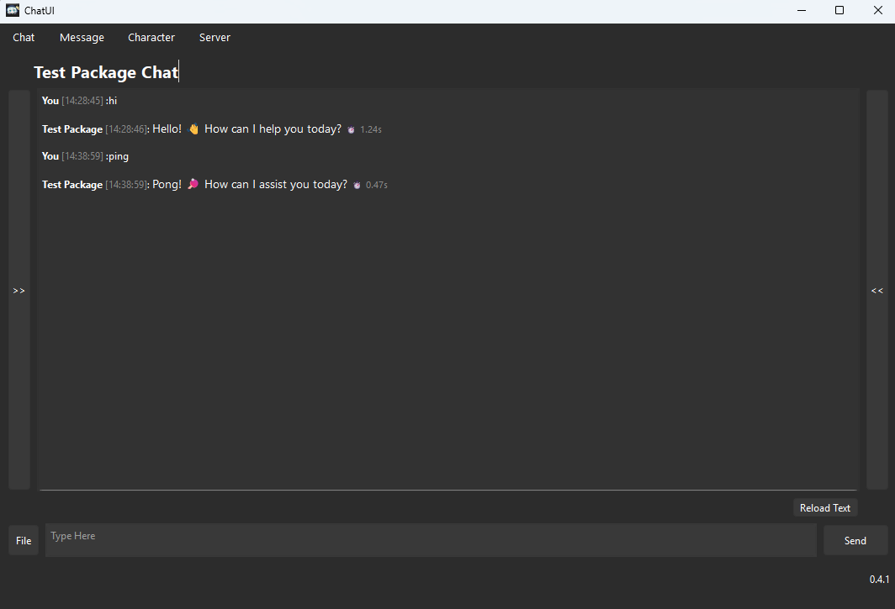
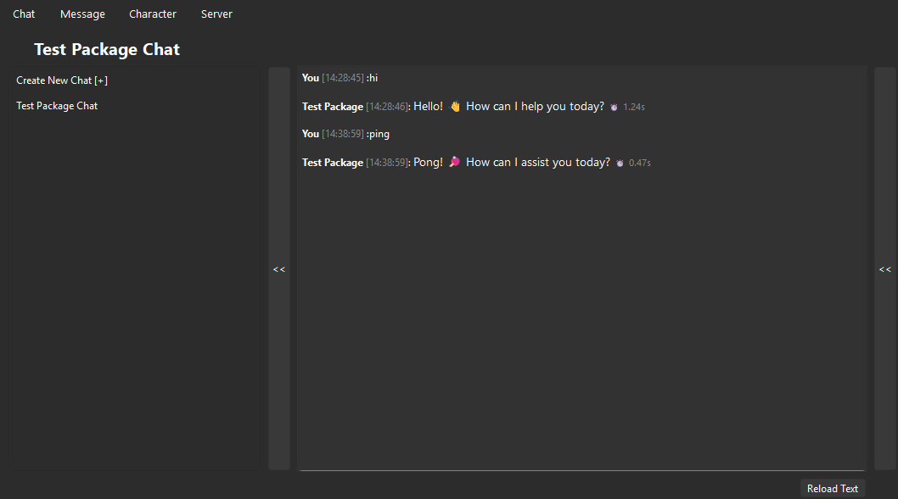
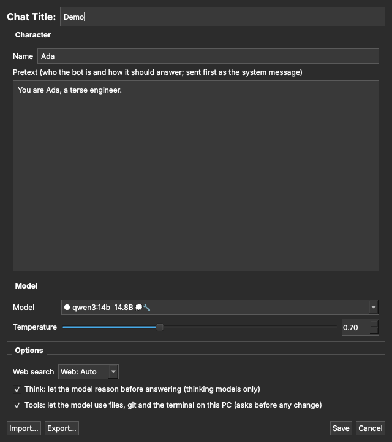
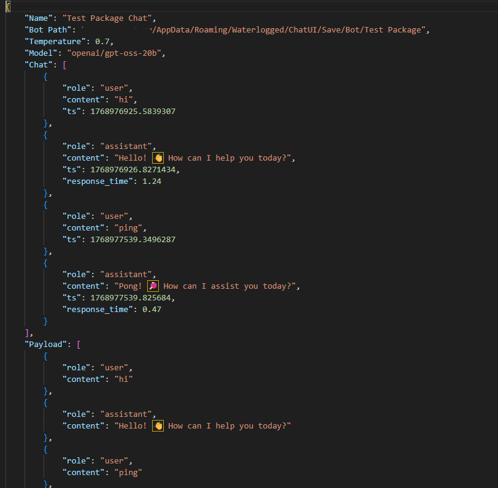

# Custom ChatUI At Home
# 1. Introduction
LLM chatbots are all the rage now a days.  I feel like it would be fun to make my own chat bot.

# 2. The LLM
This project WILL NOT focus on the LLM itself.  I didn't train my own LLM. I don't have the hardware or knowledge to pull of such a feat.

## 2.1. Setup
### Server
- AMD 9xxxX3D
- 64GB of Ram
- RTX5090
- Ubuntu 24.04

### Client
- Windows PC

## 2.2. Server
Despite such beefy of a machine.  I'm still choking on both d and v ram, besides since I wanted to access the chatbot remotely in the future anyways.  I decided to have this machine as a dedicated LLM server that I can just run all the time and other devices can access its services via LAN. 

## 2.3. VLLM
The server utilises vllm for the llm processing.  I have tried OpenUI beforehand but it keeps crashing with ComfyUI api, something i want to tinker with later on the line.  Besides i can't fully customise it for future development.  Meanwhile vllm still uses OpenAI style operations and it only takes 1 shell script to launch the entire thing without much effort.

While the current script allow model switching to vllms found on HuggingFace, it has so many bugs at the moment that it just default runs openAI's chatGPT 4.0 model.
# 2. Client UI
Despite the whole project being about AI chatbots, the AI part is all ready made and simple to set up.  What really was the focus, at least at this point of the project, is the HMI to use the AI chatbot.  The client UI is what sends messages to the LLM server with specific instructions and configs and relays whatever response it gets to the user in a clear and organised manner.  The app was written with Qt6 and programmed in Python.

## 2.1. Main Chat Window
The Main interface of the client UI. With Top bar tools to create new chats, edit current chat settings, set llm server ip, and edit messages.

The main area is a window that shows all the interaction between the user and the bot.  The interactions are timestamped with response times recorded while the texts support markdown formats for enhanced readability.  The bottom bar allows multi row text input.  So code pasting is feasible for self sustained vibe coding development.  There are also 2 pop up side bars on the sides for chat selection list and image browser respectively, with edit and delete message functions, the UI functions really similar to modern chatbot applications on the market.

## 2.2. Chat Settings (v0.9)
Every chat has its own settings, saved inside the chat file: the chat title, the **character** (a name and the pretext sent first as the system message), the **model** and temperature, **web search**, **Think** and the **tools** (File browsing, Git and Run). Open them from *Character > Settings…* or *Chat > Chat Settings* (Ctrl+E); *Chat > New Chat* opens them for a new chat. The model picker above the message box (left, next to the 📁 folder buttons) is a quick shortcut to the same setting: changing it there changes it in the settings too.

*Export…* in the settings window saves a chat's settings to a small `.json` you can share. It opens a save dialog (File Explorer on Windows) with the file named after the chat, `{chat name}.json`; rename it or pick another folder there, and the next export or import opens in that folder; *Import…* loads one into the window to check before you press *Save*. Anything missing or invalid in an imported file takes its default, so partial files and the old `Bot Description.json` files import too. The defaults and checks live in `Code/chat_settings.py`.

Chats from before 0.9 kept their character in a separate bot folder (`Save/Bot/<name>/Bot Description.json`) and a duplicate "Payload" copy of the conversation. Opening such a chat copies its character into the chat file and drops both; the old `Save/Bot` folders are no longer read and can be deleted.

# 2.4. Save Files
All settings and logs are saved by the client. Each chat is one `.json` in `Save/Chat` holding its title, its settings, its linked tool folders, the conversation and the rolling summary. `.temp.json` keeps the last opened chat and the order of the chat list, so the list shows the most recently used chats first. `links.json` keeps projects, personalities, links and where each node sits in the link graph, and `Save/Projects` and `Save/Personalities` hold their folders. `.temp.json` also keeps the **sections** of the chat list: *Create New Section [+]* adds one, and you drag chats onto a section to group them, or out of it to ungroup them. Dragging a section moves it up or down, and right-clicking renames or deletes one (its chats stay). Sections are only labels; the chats in one share nothing. Each request to the LLM is rebuilt from the conversation, the pretext and the summary; older messages are folded into the summary to keep the prompt short.

# 2.5. Reasoning, Files and Web Search (v0.5)
The client now talks to the Ollama server in `Server/ollama` (see its README). Each reply can:
- **Think first.** With *Think* on in the chat's settings, the model's own reasoning streams in grey and then folds into a "💭 Thought for Ns" line you can click to expand. Reasoning is never sent back as context.
- **Read images and files.** The *File* button attaches images (sent to vision models), PDFs, Word documents and text or code files.
- **Search the web.** In the chat's settings, *Web: Auto* lets the model decide when a question needs a search; *Always* and *Off* force it. Answers cite their sources, listed under the reply.

Long chats keep the newest messages word for word and fold older ones into a running summary that is only refreshed every few messages. The server address can include a port (`192.168.0.192:8100`); the default port is 8100.

## 2.6. Tools on your PC: file browsing, git and run (v0.12)
The model can work on the Windows PC the client runs on, not only on files you attach (models marked 🔧 in the model list). A chat's settings turn on each kind of tool separately:
- **File browsing:** list folders, find files by name, search inside files, read text files (PDF and Word through the server), create, edit, copy, move and delete (to the Recycle Bin).
- **Git:** status, diff, log, show and branches; add, commit, switch, pull, push and clone; any other git command.
- **Run:** runs scripts, programs and PowerShell (or cmd) commands and reads their output.

The model only gets the tools that are on; it's told which kinds are off, and asking for one of them returns an error instead of running. Chats saved before 0.12 had a single *Tools* switch, which becomes all three.

**GitHub sign-in.** There's one login for the whole program, under **Settings > General**: its *GitHub…* button opens a small window that signs git in to GitHub, so the model's pull, push and clone work on private repositories and pushes don't stop for a password. *Sign in with browser* uses Git Credential Manager (it comes with Git for Windows) to open GitHub's sign-in page. Or paste a personal access token (the link makes one with the `repo` and `workflow` scopes); it's checked with GitHub, then handed to git's credential helper, and the app keeps no copy. *Sign out* forgets it. The same window sets the name and email commits are made with (`git config --global user.name/user.email`). It's all git's own login, so it also works in a terminal, and a login made in a terminal shows up here. General Settings shows the account next to the button (*✓ Connected as name*, or *Not signed in*). Whether a model may use git stays a choice on the Git row of each chat or personality. The code is in `Code/local_tools/github_login.py`.

Reading never asks. Every change and every command opens an *Allow / Always allow / Deny* box first, showing exactly what will run ("Show Details" has the full arguments); *Always allow* lasts until the app is closed. The 📁 button links a folder for the model to work in, and you can link several. The ▾ next to it drops down the linked folders, shortened to drive, parent and folder (`C:/.../Projects/ChatUI`), each with an **x** to unlink it. The model is told which folders are linked and starts in the first one. Each chat remembers its own folders. The 🐙 button drops down your own GitHub repositories, most recently pushed first, once you're signed in; **Other…** at the bottom takes any other link (or `owner/repo`). The ▾ next to it lists the linked ones, each opening in your browser, with an **x** to unlink it. Long lists get a scroll bar. The model is told which repositories are linked and clones one with its git tools when it needs the files, which asks you first as usual. The tools run in the client (`Code/local_tools/`), so the server never touches your files. Git must be installed (Git for Windows). Tests: `cd Code` then `python -m pytest -q tests`.

## 2.6.1. Memory (v0.15)
Each chat has its own notes: Markdown files in `Save/Chat/<chat name>/memory`, which move with the chat if you rename it. Every `.md` there is sent to the model with each reply (up to 20,000 characters in all), as context and rules for that chat only. Models that can call tools (🔧) write them with `save_memory`, `read_memory` and `delete_memory`; saving and deleting ask you first, like every other change. The **Memory** section of Chat Settings lists the notes, turns them off for the chat and opens the folder, where you can add or edit notes yourself.

## 2.6.2. Link graph (v0.16)
**Chat > Link Graph** (Ctrl+G) connects chats to projects and personalities. Chats are chat bubbles, projects are squares and personalities are triangles. A chat with no links stays on its own and shares nothing, and only the open chat shows until you turn on **Show unlinked chats** or search for one.

| To | Do this |
|---|---|
| Move a node | Drag it. It stays where you drop it (right-click > Unpin lets it go) |
| See its details and actions | Click it |
| Link two nodes | Double-click one, then click a lit node. Esc or empty space cancels |
| See a node's direct links | Hover over it |
| Remove a link | Click it and press Delete, or right-click it |
| Zoom and move around | Scroll, and drag empty space |

| Link | What it means |
|---|---|
| Chat to project (solid) | The chat is a session of the project. Sessions can read each other and get the project's memory notes |
| Chat to personality, **speaks as** (thick) | The chat talks as that personality. A chat has one at most |
| Chat or project to personality, **can read** (dashed arrow) | Chats speaking as that personality can read this chat, or every session of this project. Nothing comes back the other way |

A chat can also use the folders and GitHub repositories of every chat it can read. They show in its ▾ lists with a 🔗 (the count reads like `▾ 2 +3`), and aren't saved into its own lists. Only their paths go to the model, up to 15 of each, and it opens what it needs, so this adds very little context. A private chat's folders stay out of a personality's reach, as its messages do.

Linking two chats offers to make a project for them. **Keep private from personalities** stops every personality reading a chat, even a linked one; the other sessions of its own projects still can.

**Personalities** are optional, so a chat without one keeps all its settings to itself. Chat Settings > Personality saves a character, voice, 3D model settings and LLM model under a name with *Save as personality…*, and picks one under *Talks as*. A chat always takes its personality's name, description, Git switch and memory notes. It takes the **Voice**, **3D model** and **LLM model** settings too unless you untick them, there or in the chat's panel in the graph; unticked ones stay the chat's own. It follows its personality except for what you change in that chat, and unlinking gives the chat its own settings back. To change a personality, click it in the graph and choose **Edit settings…**, which opens the settings window on it, or press *Update personality* in a chat, which saves that chat's ticked values. Either way, whatever you changed reaches every chat speaking as it, even one that had changed that setting itself; only what a chat has unticked stays its own. File and run tools, web search, pictures and the chat's own memory switch always stay with the chat, and a chat's conversation isn't copied anywhere: other chats only read it through *can read* or a shared project.

**What the model gets**: each reply sends the chat's own notes, then those of its projects, then its personality's, then a one-line list of the chats it can read, all within 20,000 characters. The list shrinks first and the chat's own notes are cut last. The chat's Memory switch only covers its own notes, and notes from other projects aren't sent. Models that can call tools (🔧) can look through linked chats with `list_linked_chats`, `search_linked_chats` and `read_linked_chat`, which only read and show in the chat like any other tool, and can save notes to a project or personality by naming it in `save_memory`. Each linked chat's line is a sentence the model writes after a few messages, refreshed every 10, which starts a small extra request to the server.

## 2.7. Voice input (v0.10)
The 🎤 button between the message box and *Send* lets you speak instead of typing. Click it (or press Ctrl+M) and talk; the button turns red and counts the time, and the status line shows the microphone level. Click it again (or Ctrl+M) to stop, or press Esc to throw the recording away. The clip goes to the server, where Whisper writes it down, and the text lands in the message box at the cursor so you can fix it before sending. Right-click the button for:
- **Send automatically after speaking**, which sends the text straight away;
- **Language**: detect automatically (the default), English, Chinese, Cantonese or Japanese.

The client records with Qt Multimedia, which comes with PySide6, so there is nothing extra to install on Windows. Windows must allow desktop apps to use the microphone (*Settings > Privacy & security > Microphone*). The server needs `faster-whisper` (in its `requirements.txt`); the first clip after the server starts takes longer while it loads the model, and the very first one also downloads it. See *Speech to text* in `Server/ollama/README.md`.

## 2.8. Text to speech (v0.11)
Turn on *Text to speech* in a chat's settings (the *Voice* box) and every reply gets a **▶ Play** button under it. Click it to hear the reply; it turns into **⏸ Pause**, then **▶ Resume**. Once a reply has played, the button goes back to **▶ Play**, so you can play it again as often as you like; replays come from a copy kept on this PC (`Audio/` in the client data folder), so they start straight away. With *Play each new reply automatically* on, new replies are read out as they arrive. Turn text to speech off and the Play buttons and the voice settings disappear.

The server makes the audio, so each chat's choice goes to it with every request:
- **Engine**:
  - *Microsoft Edge voices*: online, natural, hundreds of voices in most languages, Cantonese `zh-HK` included. Nothing to set up.
  - *Kokoro*: runs on the server with no internet, natural voices (★ marks the best ones), English, Mandarin, Japanese and more. One `pip install` on the server; its model downloads by itself.
  - *Chatterbox*: runs on the server, the most human-sounding, and can copy anyone's voice from a short recording you drop into `Server/ollama/voices/chatterbox/`. Best with an NVIDIA GPU; speed is fixed.
  - *Piper*: runs on the server, very light, plainer voices that are downloaded one by one.
  - *GPT-SoVITS*: runs on the server's GPU as its own program, with voices you **train** from a few minutes of someone's recordings; the closest to a real person, and strong in Japanese, Chinese and Cantonese. See *GPT-SoVITS* in `Server/ollama/README.md`.

  Engines the server doesn't have yet say so, with the command to install them (see *Text to speech* in `Server/ollama/README.md`).
- **Language** narrows the voice list; **Voice** picks the speaker, and **▶ Test** plays a short line in that voice.
- **Speed**, from 0.5× to 2×.
- **Speak in the voice's language**: the reply stays as written in the chat, but before it is read out the chat's own model translates it into the voice's language, so an English reply can be heard in Japanese from a Japanese voice (or in Cantonese from a `zh-HK` voice). A **🌐 Spoken in ja-JP ▸** link under the reply shows the translation; it is saved with the chat, and replays reuse the audio without translating again.

Markdown, code blocks, links and source numbers like `[1]` are left out of what is read.

## 2.9. 3D model (v0.14)
Tick *3D model* in a chat's settings (the *Character* box) and the 3D character (the ChatUIAvatar Unity app, running on the same PC) acts out every reply and speaks it. Turning her on also turns *Text to speech* and *Play each new reply automatically* on; the voice stays on until she's turned off again. Pick her voice under *Voice* as usual (a GPT-SoVITS voice trained on her recordings fits best).

- **She reacts and poses.** Before each request the client asks her what she can do (`GET /api/catalog`: faces, special faces, moves, presets and her posture) and tells the model, which then writes stage directions into its reply: `[[face: happy 0.7 | move: wave]]` at the start, and another before a sentence where her feeling changes. They never show in the chat and are never spoken. The first one plays as soon as it streams in; the later ones play when the speech gets to them. Names the model makes up are dropped.
- **She speaks.** Her mouth follows the audio: how far it opens comes from the loudness of the clip (WAV voices: GPT-SoVITS, Kokoro, Chatterbox, Piper), or from the text for Edge's MP3s, and the mouth shape (A, I, U, E, O) from the vowels of what she says, Japanese kana and Korean included.
- **Personality** (*Any*, *Tsundere*, *Kuudere*) is sent to her so she prefers matching faces, and also sets the tone of the replies. **Acting notes** below it fine-tune her: which faces and moves to favour or avoid, how big her reactions are. Both are saved per chat with the rest of the settings. The *Pretext* above is still who she is.
- *Check* shows whether she's running and how many faces and moves she has. If she isn't running, the chat works as before and the status line says so.

The replies keep their stage directions in the chat file (`acts`, with where each one was), so ▶ Play on an older reply acts it out again, and the model sees how it directed her earlier. Her address is `avatar` in `Code/UI/network.json` (default `localhost:7870`, the Avatar Api Server's port). The code is in `Code/avatar.py`.

## 2.9. Pictures with ComfyUI (v0.13)
The chat can draw pictures with ComfyUI, which runs on the server machine next to Ollama. Pick a **Workflow** in a chat's settings (the *Pictures* box) and it works like auto web search: the model decides when a picture fits (you ask for one, want to see something, or a scene is worth showing) and writes the positive and negative prompts itself. The picture appears under the reply and in the panel on the right of the chat window. *When: With every reply* draws one for each reply instead. *Off* turns it off for the chat.

- Click a picture in the chat to open it full size; double-click the panel for the same.
- **Reload Image** draws the picture in the panel again with the same prompts and a new seed.
- Pictures are kept on this PC in `Images/` in the client data folder; the chat file stores where they are.
- The model is told what it drew before, so later pictures can keep a character's looks. Describe the character's appearance in the *Pretext*, since the image model only sees the prompt.

The workflows are ComfyUI graphs saved with *Workflow > Export (API)* into `Server/ollama/workflows/` on the server, with `{{positive}}` and `{{negative}}` typed into the prompt boxes (see `Server/ollama/workflows/README.md`). The list in Chat Settings reloads each time you open it, so a newly added file shows up without restarting anything. Server settings (ComfyUI address, sharing one GPU with Ollama) are under *Pictures* in `Server/ollama/README.md`.

## Where things live
| Name | Where | What |
|---|---|---|
| LLM server | `192.168.0.192:8100` (Ubuntu), code in `Server/ollama/` | Ollama wrapper the client talks to. Addresses: `Server/ollama/chat_server/config.py`, overrides in `Server/ollama/.env` |
| 3D model | `localhost:7870` on the client PC: `avatar` in `Code/UI/network.json` | the ChatUIAvatar app's Avatar Api Server, driven by chats with *3D model* on (`Code/avatar.py`) |
| Client git folder | `Code/` (`paths.CLIENT_REPO_DIR`) | app files: UI layouts, images, default addresses in `Code/UI/network.json` |
| Client data | `%APPDATA%\Waterlogged\ChatUI` (`paths.CLIENT_DATA_DIR`) | chats (each with its settings), your saved server address (`network.json`), reply audio (`Audio/`) and pictures (`Images/`) |
| Client PC | `192.168.0.184` (Windows) | runs `Code/`; listed in `network.json` for reference |
| NAS | `192.168.0.163` (Samba): `nas` in `Code/UI/network.json`, `NAS_IP` on the server | chat and bot saves move here next; nothing uses it yet |

Every client path and address is defined once, in `Code/paths.py`.

# 3. Future Works
I have packaged the program into a .exe app that can connect to my server machine on the same LAN.  It's now functioning enough that I can ask it to code its own code for me :).

The server only supports manual LLM switching due to my inability to code, which I'm currently tackling.  There are also tons of minor bugs but I don't plan on dealing with them right away as they don't impact the program as longs as I don't deliberately try to break it.

Right now the chatbot does not support image and file uploads, I am currently working on such functions to add multi modality to the bot for future expansion.  Some features I would like to include would be TTS and STT to streamline the chat flow.  I really hope to integrate this bot to my future projects.
